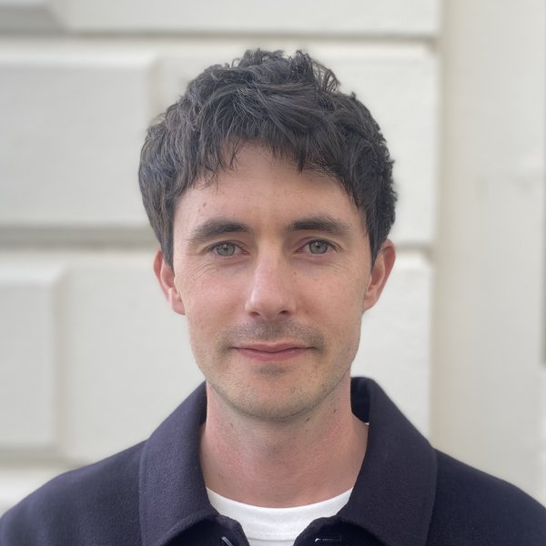
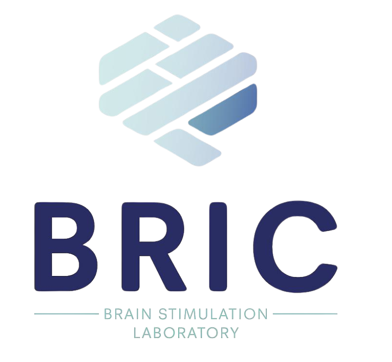

::: {.lead-text}
We're looking for healthy adults aged 21 to 65 for a paid study at the University of Plymouth, using MRI and gentle, non-invasive brain stimulation.
:::

## Why are we doing this research?

We want to understand how deep regions of the brain shape motivation, mood and decision-making, as a first step towards more precise treatments for brain conditions. To do this, we use transcranial ultrasound. It uses sound waves, like those used in pregnancy scans, but at different settings and focused on a small area deep in the brain to gently and briefly change its activity. Read more at [CENTUS](https://www.plymouth.ac.uk/research/centus).

## What's involved

::: {.steps}

::: {.step}
[At home]{.num}

### Online screening

15 minutes online. This is to make sure it's safe for you to take part. [Start the screening →](https://psysurvey.plymouth.ac.uk/limesurvey/index.php?r=survey/index&sid=910001&lang=en)
:::

::: {.step}
[Visit 1]{.num}

### MRI scan

75 minutes. We go through the study and some extra questions with you, as well as a 30 minute scan to take pictures of your brain.
:::

::: {.step}
[Visits 2 to 4]{.num}

### Ultrasound and task

90 minutes each. Up to 12 minutes of ultrasound, then a decision-making game.
:::

::: {.step}
[At the end]{.num}

### £110 + up to £30 bonus

Paid at your final visit. The bonus depends on how you do in the game. You'll also get a picture of your brain to keep.
:::

:::

**The task.** You fill a fishing net by choosing between kinds of seafood, and report how you're feeling along the way. Sensors record your heart rate, breathing and sweat response, and cameras track your eyes and face.

## Who can take part

::: {.two-lists}
::: {.list-col}
**You can take part if you're:**

- aged 21 to 65
- healthy, with no current or past mental health or neurological diagnosis
- able to come to all four visits
:::

::: {.list-col}
**You can't take part if you:**

- have metal in your body
- are pregnant
- take certain medications
- have migraines, or a personal or close family history of epilepsy
- have some other health conditions
:::
:::

The online screening checks all of this, so if you're not sure, get in touch. MRI and ultrasound stimulation are both non-invasive, and more than 300 people have had ultrasound stimulation at our centre. Taking part is voluntary and you can stop at any time without giving a reason. The [information sheet](assets/info_sheet_v3.pdf) has the full details, including how we look after your data.

::: {.background}

## How we run the study

We want our findings to apply to as many people as possible, so we aim to recruit women and men in similar numbers and welcome people of all genders. If you have access needs or anything else we should plan around, please let us know. If you have caring, work or other commitments, we'll do our best to offer sessions outside normal working hours, although some sessions will need to take place during the working day.

## The research team

::: {.person}

::: {.person-text}
The study is led by **Dr Dylan Curtin** in Professor Elsa Fouragnan's lab at the Brain Research Imaging Centre, University of Plymouth. It is part of the ULTRA-GOAL project, funded by the European Union through a Marie Skłodowska-Curie Actions postdoctoral fellowship, and approved by the University's Faculty of Health Research Ethics and Integrity Committee.
:::
:::

::: {.logo-row}

:::

::: {.disclaimer}
Funded by the European Union. Views and opinions expressed are however those of the author(s) only and do not necessarily reflect those of the European Union or the European Research Executive Agency. Neither the European Union nor the granting authority can be held responsible for them.
:::

:::
